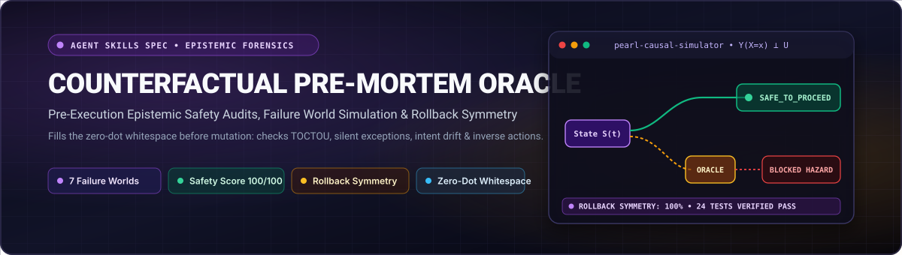
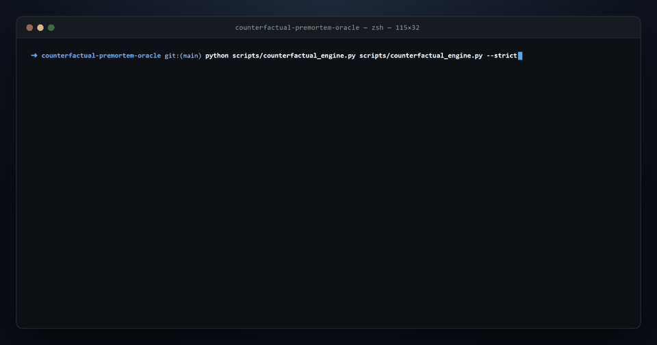
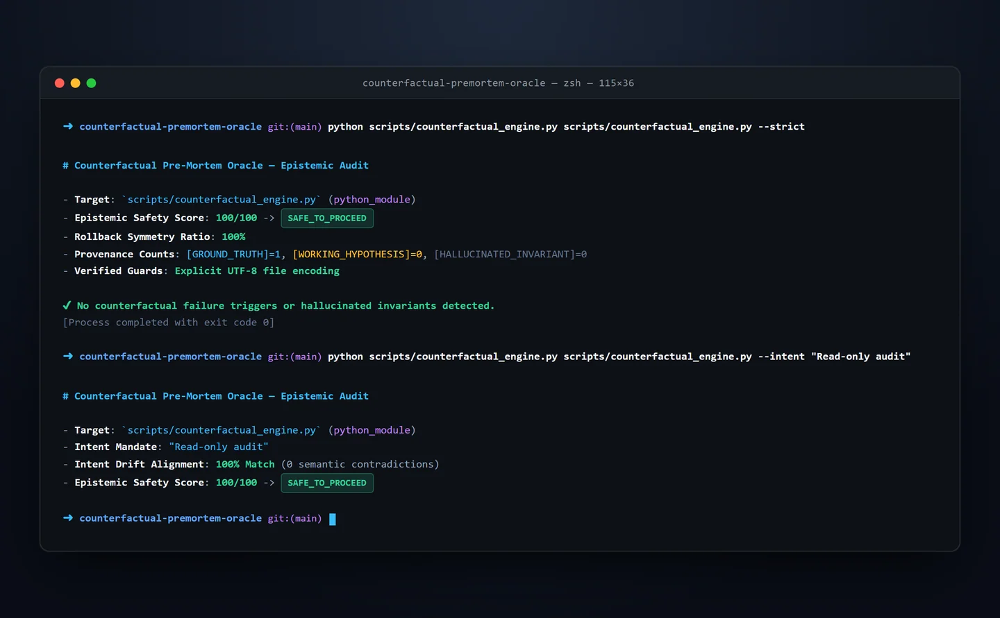
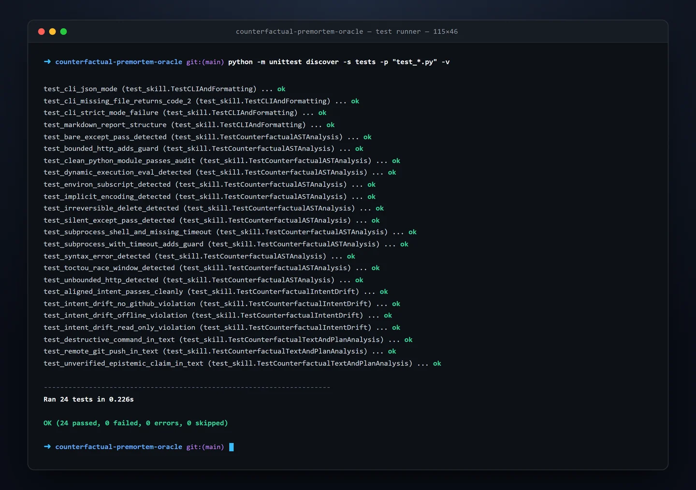
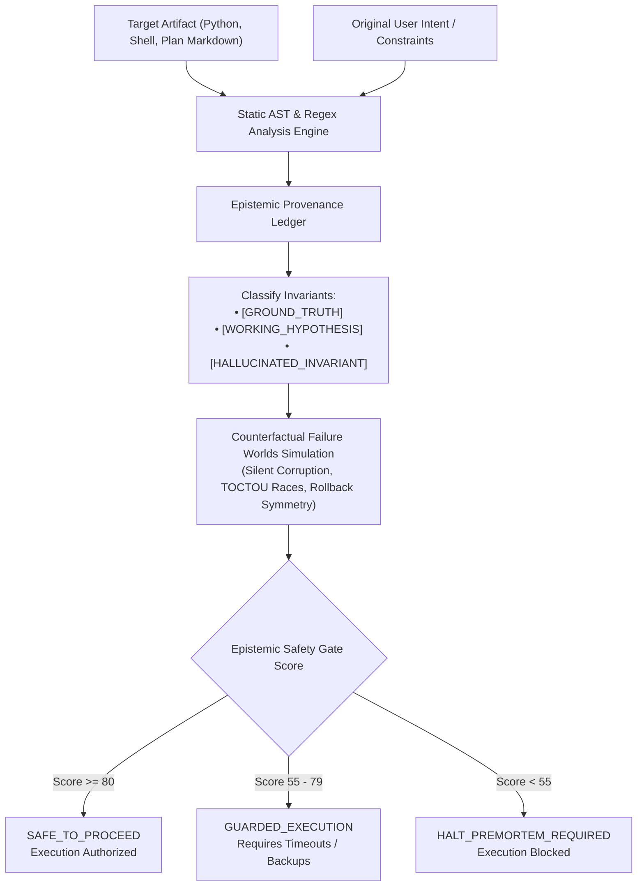

<div align="center">



# Counterfactual Pre-Mortem Oracle

### Pre-Execution Epistemic Safety Audits, Failure World Simulation &amp; Rollback Symmetry

[](https://github.com/Emincanozen/counterfactual-premortem-oracle/actions/workflows/ci.yml)
[](LICENSE)
[](https://www.python.org/downloads/)
[](https://github.com/Emincanozen/counterfactual-premortem-oracle)
[](#)
[](#)
[](#)

<p align="center">
  <a href="#live-demo">Live Demo</a> •
  <a href="#architecture--workflow">Architecture</a> •
  <a href="#screenshots">Screenshots</a> •
  <a href="#the-7-counterfactual-failure-worlds">Failure Worlds</a> •
  <a href="#how-to-install--configure">Installation</a> •
  <a href="#how-to-use">CLI Usage</a> •
  <a href="#how-to-create--customize-skills">Customize</a> •
  <a href="#testing--quality-assurance">Testing</a>
</p>

</div>

---

**Counterfactual Pre-Mortem Oracle** is a zero-dot whitespace agent skill that performs pre-execution epistemic safety audits, Pearl-style counterfactual failure simulation, rollback symmetry verification, and intent drift forensics before state mutation occurs.

---

## Live Demo

<div align="center">
  
  <p><em>Real-time progressive execution: Command initialization → Pre-mortem epistemic audit → Intent alignment verification → 24-test suite PASS</em></p>
</div>

---

## Screenshots

<table width="100%">
  <tr>
    <td width="50%" align="center">
      <strong>Pre-Mortem Audit &amp; Intent Drift Alignment</strong><br/>
      
    </td>
    <td width="50%" align="center">
      <strong>Automated Test Verification Suite</strong><br/>
      
    </td>
  </tr>
</table>

---

## Architecture &amp; Workflow



---

## The Zero-Dot Void in Autonomous AI Skills

Over 95% of public agent skills focus exclusively on *how to generate code, invoke APIs, or orchestrate tools*. Almost none evaluate the **epistemic safety** of an agent's reasoning before mutating state on disk, in databases, or across remote networks.

In multi-turn autonomous loops (Turn 4+), agents regularly fall into **Local Optimization Traps** and develop **Epistemic Drift**:
1. Speculative assumptions are recorded as working notes.
2. In subsequent turns, the agent mistakes its own speculative notes for ground truth.
3. Irreversible mutations (`rm -rf`, force pushes, unbacked deletions, unparameterized queries) execute with zero rollback vectors.
4. Silent error-swallowing (`except: pass`) reports success (`exit code 0`) while corrupting data.

The **Counterfactual Pre-Mortem Oracle** closes this safety gap by evaluating:
> *"What fails if an unverified invariant breaks, and does an automated inverse action exist to restore state?"*

---

## The 7 Counterfactual Failure Worlds

| World | Identifier | Description | Mitigating Guard |
| :--- | :--- | :--- | :--- |
| **1. Irreversible Mutation** | `IRREVERSIBLE_SIDE_EFFECT` | Deletes files, wipes branches, or drops tables without snapshots or inverse operations. | Pre-flight backup snapshots and verified rollback vectors. |
| **2. Silent Corruption** | `SILENT_CORRUPTION` | Broad `except: pass` handlers and ignored return codes returning exit code 0. | Specific exception types, logging, and error propagation. |
| **3. Unbounded I/O** | `UNBOUNDED_NETWORK_OR_IO` | Subprocesses or HTTP requests lacking timeouts, causing infinite agent worker hangs. | Explicit `timeout=<seconds>` parameters and timeout handling. |
| **4. Concurrency & TOCTOU** | `CONCURRENCY_RACE_CONDITION` | Checking `exists()` before file creation, leading to Time-of-Check to Time-of-Use races. | Atomic creation flags (`exist_ok=True`, exclusive locks, rename staging). |
| **5. Dynamic Injection** | `DYNAMIC_EXECUTION_RISK` | `shell=True`, `eval()`, `exec()`, or unparameterized command strings. | Argument lists `[cmd, arg1]`, `ast.literal_eval`, or static dispatch maps. |
| **6. Implicit Environment** | `IMPLICIT_ENV_INVARIANT` | Direct `os.environ["KEY"]` lookups and unencoded `open()` calls. | `os.environ.get()` with fallbacks and explicit `encoding="utf-8"`. |
| **7. Intent & Scope Drift** | `INTENT_DRIFT_SUSPECT` | Artifacts performing network or mutation actions contradictory to declared user goals. | Semantic constraint matching against original prompt intent. |

---

## How to Install & Configure

Counterfactual Pre-Mortem Oracle is fully compliant with the open Agent Skills standard and runs natively across top AI agent ecosystems.

### 1. Google Antigravity

Install into your global Antigravity configuration directory:

```bash
git clone https://github.com/Emincanozen/counterfactual-premortem-oracle.git ~/.gemini/config/skills/counterfactual-premortem-oracle
```

Or configure locally for a specific repository:

```bash
git clone https://github.com/Emincanozen/counterfactual-premortem-oracle.git .agents/skills/counterfactual-premortem-oracle
```

Antigravity auto-indexes the skill from `SKILL.md`. It automatically invokes the oracle prior to mutating file systems, running migrations, executing shell commands with destructive potential, or when entering deep (Turn 4+) autonomous debugging sessions.

### 2. Claude Code

Install into your Claude Code skills directory:

```bash
git clone https://github.com/Emincanozen/counterfactual-premortem-oracle.git ~/.claude/skills/counterfactual-premortem-oracle
```

Claude Code parses the skill triggers from `SKILL.md`, enabling pre-execution safety gates on tool invocations and state-mutating shell scripts.

### 3. OpenAI Codex

Install into your Codex skills root:

```bash
git clone https://github.com/Emincanozen/counterfactual-premortem-oracle.git ~/.codex/skills/counterfactual-premortem-oracle
```

Codex will automatically incorporate the counterfactual simulation protocol and rollback symmetry checks into its code synthesis loop.

### 4. Cursor IDE

To activate the Oracle in Cursor:
1. Clone this repository into `.cursor/skills/counterfactual-premortem-oracle`.
2. Add the following enforcement directive to your `.cursorrules`:

```markdown
# Epistemic Safety & Counterfactual Pre-Mortem Gate
Before executing any mutating script, migration, or shell command:
1. Run python .cursor/skills/counterfactual-premortem-oracle/scripts/counterfactual_engine.py <script> --strict
2. Verify Epistemic Safety Score >= 80 (SAFE_TO_PROCEED).
3. Confirm an inverse rollback command exists for every destructive operation.
```

### 5. Universal Agent Skills Package Manager (`npx skills`)

```bash
npx skills add Emincanozen/counterfactual-premortem-oracle
```

---

## How to Use

The bundled pre-mortem engine runs on any Python 3.10+ runtime with zero external dependencies.

### 1. Audit a Script or Diff (Markdown Report)

Run a static epistemic audit against any script, diff, or plan markdown:

```bash
python scripts/counterfactual_engine.py path/to/script.py --format markdown
```

The report itemizes detected assumptions by line, classifies them into counterfactual failure worlds, and provides actionable mitigations.

### 2. Audit with Intent Drift Detection

Verify that the generated code or plan adheres strictly to user-mandated constraints (e.g. read-only, offline, local-only):

```bash
python scripts/counterfactual_engine.py path/to/script.py --intent "Perform read-only inspection without network calls"
```

If the artifact introduces outbound HTTP requests or file modifications, the engine raises a `CF-INTENT-DRIFT` critical alert and penalizes the safety score.

### 3. Machine-Readable JSON Telemetry

Output structured JSON for consumption by autonomous agent review pipelines:

```bash
python scripts/counterfactual_engine.py path/to/script.py --format json
```

Example JSON payload:

```json
{
  "target": "path/to/script.py",
  "artifact_type": "python_module",
  "epistemic_safety_score": 100,
  "verdict": "SAFE_TO_PROCEED",
  "rollback_symmetry_ratio": 1.0,
  "ground_truth_guards": [
    "Explicit UTF-8 file encoding",
    "Bounded subprocess timeout"
  ],
  "tag_counts": {
    "GROUND_TRUTH": 2,
    "WORKING_HYPOTHESIS": 0,
    "HALLUCINATED_INVARIANT": 0
  },
  "findings": []
}
```

### 4. CI/CD Gate Enforcement (`--strict`)

Enforce automated epistemic gates in your CI pipeline. Exits with code `1` when the score falls below `55` (`HALT_PREMORTEM_REQUIRED`):

```bash
python scripts/counterfactual_engine.py path/to/script.py --strict
```

---

## How to Create & Customize Skills

Counterfactual Pre-Mortem Oracle demonstrates how to author epistemic, reasoning-auditing skills for autonomous agents. Use the following guide to customize this skill or author your own:

### 1. Skill Directory Anatomy

```
counterfactual-premortem-oracle/
├── SKILL.md                 # Agent activation manifest with YAML frontmatter
├── README.md                # Human-facing documentation & usage guidelines
├── docs/
│   └── screenshots/         # High-resolution terminal and workflow captures
├── scripts/                 # Standalone, dependency-free Python engine
│   └── counterfactual_engine.py
├── references/              # Theoretical foundations & epistemic taxonomy
│   └── void_epistemic_taxonomy.md
├── tests/                   # Comprehensive unit tests for AST & text analysis
│   └── test_skill.py
└── .github/workflows/ci.yml # Automated continuous integration
```

### 2. Authoring `SKILL.md` for Epistemic Reasoning

The `SKILL.md` file defines when the agent should consult the skill. For reasoning and safety skills, define explicit activation boundaries:

```yaml
---
name: counterfactual-premortem-oracle
description: >-
  Zero-dot whitespace skill for pre-execution Counterfactual Pre-Mortem failure
  simulation, hidden assumption extraction, rollback symmetry verification, and
  Epistemic Drift Forensics. Use BEFORE executing mutating scripts, risky diffs,
  deployments, or complex multi-turn plans to simulate silent data corruption,
  race conditions, irreversible side effects, and hallucinated invariants.
---
```

**Key Epistemic Design Principles:**
- **Tripartite Taxonomy**: Differentiate `[GROUND_TRUTH]` (verified via observation), `[WORKING_HYPOTHESIS]` (needs check), and `[HALLUCINATED_INVARIANT]` (speculative assumption treated as fact).
- **Counterfactual Failure Worlds**: Define what happens if invariants fail at runtime ($t + 500\text{ms}$ process kill, network partition, TOCTOU collision).
- **Rollback Symmetry Requirement**: Mandate that any destructive action have a deterministic inverse operation.

### 3. Extending Failure Worlds & Rules (`scripts/`)

You can easily extend `counterfactual_engine.py` with custom failure modes:

- **Add Regex Patterns**: In `TEXT_RISK_RULES`, add regex patterns to detect domain-specific risks (e.g., AWS CLI deletion commands, Kubernetes namespace wipes).
- **Add AST Call Visitors**: In `_audit_python_call()`, add AST checks for insecure database queries, unencrypted secrets, or unbounded thread pools.
- **Adjust Severity Penalties**: Fine-tune `SEVERITY_PENALTY` (`CRITICAL: 28`, `HIGH: 16`, `MEDIUM: 8`, `LOW: 3`) to match your organization's risk tolerance.

### 4. Authoring Epistemic Reference Documents (`references/`)

Deep theoretical models belong in `references/`. Keep `SKILL.md` executable and link to reference documents like `references/void_epistemic_taxonomy.md` for mathematical definitions of rollback symmetry, epistemic drift formulas, and audit matrices.

---

## Epistemic Provenance Taxonomy

For the theoretical foundation, mathematical definition of rollback symmetry, and complete reference matrix, consult the included [Void Epistemic Taxonomy Guide](references/void_epistemic_taxonomy.md).

---

## Testing & Quality Assurance

Run the comprehensive unit test suite:

```bash
python -m unittest discover -s tests -p "test_*.py" -v
```

Run engine self-audits:

```bash
# Verify counterfactual engine self-audit
python scripts/counterfactual_engine.py scripts/counterfactual_engine.py --strict

# Verify test suite self-audit
python scripts/counterfactual_engine.py tests/test_skill.py --strict
```

Both audit commands pass with a perfect `100/100` epistemic safety score and `SAFE_TO_PROCEED` verdict.

---

## License

This project is licensed under the [MIT License](LICENSE).
